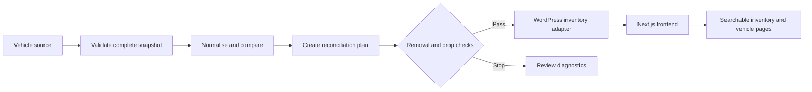

# Architecture and boundaries

The private frontend uses Next.js/React/TypeScript with WordPress as a headless content layer. Vehicle metadata helpers provide canonical URLs, Open Graph information and structured data. Publishing and synchronisation have GitHub Actions workflows.

The selected sample contains two pure behaviors: canonical JSON ordering for stable comparison, and a guard checking proposed removal count and inventory drop ratio. It does not include source validation, authentication, payload hashing, mapping, reconciliation, network retries or writes. Array order is preserved by canonicalisation because image order can carry meaning.

The browser preview constructs a hypothetical plan from two counts, assuming retained IDs overlap. Real reconciliation compares stable source identifiers. A higher current count can still hide many removed IDs; therefore count-only inspection is not a substitute for the private reconciliation plan.

Default thresholds are code defaults, not a universal operating policy. The tests cover the limits, including equality and independently triggering absolute/relative thresholds.
