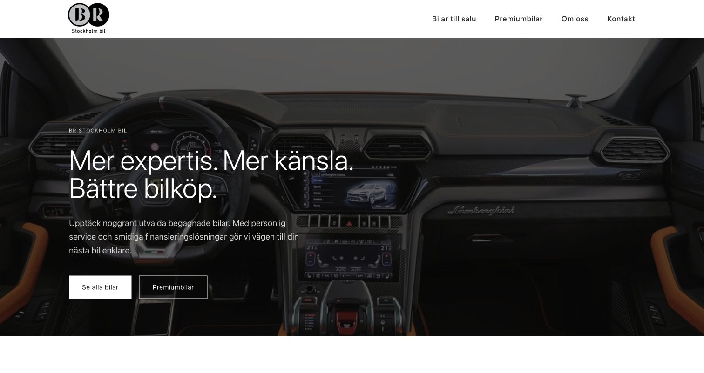

# BR Stockholm Bil — Headless Website & Inventory Automation

**[Open the live website →](https://www.brstockholmbil.se/)** · [](https://github.com/ismail-bellakhel/br-stockholm-bil-showcase/actions/workflows/verify.yml)

**A dealership website connecting vehicle listings, technical SEO and a repeatable publishing workflow.**

Public showcase by **Ismail Bellakhel**. The live website, screenshots and selected code are included; the complete application and its Git history remain private.



## Start here — a two-minute review

1. Visit the [dealership website](https://www.brstockholmbil.se/) to inspect the customer experience.
2. Browse the vehicle catalogue, open a vehicle page and explore the contact journey.
3. Read [sample.mjs](sample.mjs) for selected inventory safeguards and [ARCHITECTURE.md](ARCHITECTURE.md) for the broader system.

## Problem and contribution

Keeping vehicle information in multiple places creates repetitive work and a risk of inconsistent listings. I built a headless dealership website and worked on the integration and publishing workflow so the catalogue can reuse an existing vehicle source.

The implementation connects a Next.js frontend to WordPress content and inventory data. Vehicle pages expose specifications, pricing and contact paths. The private sync workflow validates the source, normalises records, compares snapshots and checks proposed removals before applying changes. GitHub Actions supports repeatable deployment and inventory workflows.

## Selected engineering decision

**Treat an unexpected inventory drop as a review event.** An incomplete upstream response should not silently archive a large portion of the visible catalogue. The sample contains the original pure snapshot guard and canonical JSON helper. The preview uses synthetic counts and an assumed overlap of vehicle IDs; it is not the full reconciliation algorithm.

| Included here | Kept in the private application |
| --- | --- |
| Canonical payload comparison helper | Full vehicle mapping and source access |
| Snapshot removal/drop safeguards | WordPress write adapters and sync orchestration |
| Interactive dry-run example and tests | Deployment configuration and credentials |
| Architecture and scope notes | Full frontend and historical commits |

## Selected code checks

The main preview opens the actual dealership website. The selected safeguard functions remain available for technical review without sharing the complete application.

```sh
npm test
```

These tests use synthetic inventory plans and make no changes to live listings.

## Outcome and limits

The public site demonstrates the delivered customer journey. This repository demonstrates selected integration behavior. Revenue lift, conversion improvement and time savings are not quantified here because verified measurements are not included.

**Skills demonstrated:** marketing technology integration, headless delivery, technical SEO, inventory data quality, automation and operational safeguards.

## Code provenance

`sample.mjs` contains selected pure functions from `scripts/sync/inventoryCore.mjs` in my private project, inspected at commit `0db86df`. `index.html` and the synthetic tests were prepared specifically for this public excerpt. No private repository history is included.

See [SCOPE.md](SCOPE.md) for publication boundaries. This showcase is not distributed under an open-source license.
